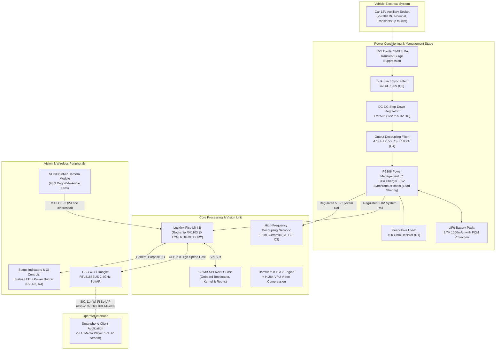
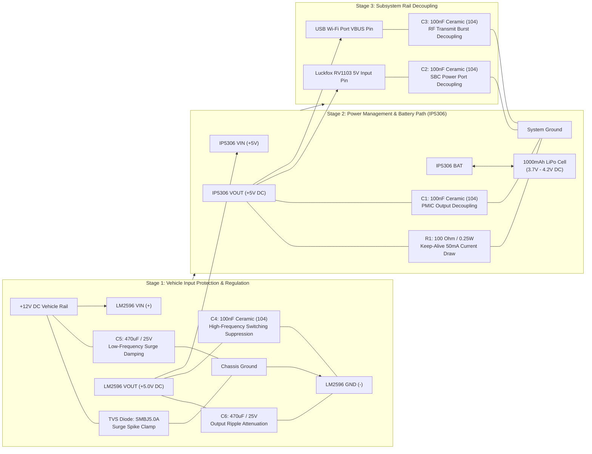
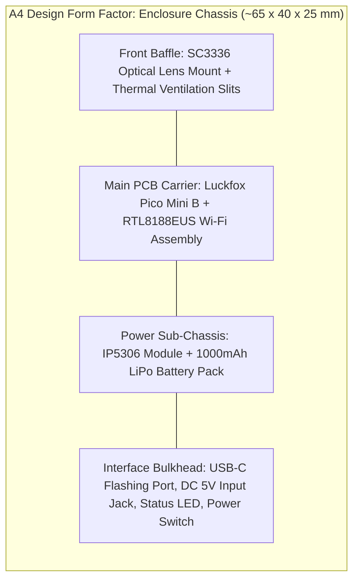

```text
╔══════════════════════════════════════════════════════════════════════════════════════════════════════╗
║ 1                                              2                                                   3 ║
║   ╔══════════════════════════════════════════════════════════════════════════════════════════════╗   ║
║ A ║ SPECIFICATION SHEET: HARDWARE ARCHITECTURE & SUBSYSTEM INTERCONNECTS                       ║ A ║
║   ║ CLASSIFICATION: CONFIDENTIAL / PROTOTYPE ENGINEERING                                        ║   ║
║   ╚══════════════════════════════════════════════════════════════════════════════════════════════╝   ║
╚══════════════════════════════════════════════════════════════════════════════════════════════════════╝
```

# Engineering Specification: Hardware Architecture & Subsystem Interconnects

---

## 1. System Engineering Scope

This specification defines the hardware architecture for an ultra-low-cost, battery-buffered automotive vision streaming prototype.

Primary technical metrics:
- Image Sensor: SC3336 3MP CMOS Image Sensor (MIPI CSI-2, 2-lane, D-PHY).
- Processing Unit: Luckfox Pico Mini B (RV1103 SoC, 64MB DDR2, 128MB SPI NAND) with integrated ISP 3.2 and dedicated hardware H.264/H.265 VPU.
- Storage Architecture: Zero external SD card dependency; boot and runtime firmware execute from onboard 128MB SPI NAND Flash.
- Video Transmission: Point-to-point wireless transmission over 802.11n 2.4GHz SoftAP using RTSP/RTP transport.
- Electrical Power Interface: 12V DC vehicle input with transient suppression (TVS clamp + LC/RC multi-stage filtering), step-down regulation to 5.0V DC, and autonomous single-cell LiPo battery management with load-sharing.

---

## 2. Top-Level Functional Architecture



---

## 3. Power Conditioning & Protection Circuit Topology



---

## 4. Hardware Data Pipeline & Internal SoC Architecture

```mermaid
flowchart LR
    subgraph SENSOR_UNIT ["Camera Sensor (SC3336)"]
        OPTICS["Optical Lens Assembly (98.3 Deg FOV)"]
        PIXELS["3MP CMOS Pixel Sensor (2304x1296)"]
        TX_PHY["MIPI D-PHY Transmitter Block"]
        OPTICS --> PIXELS --> TX_PHY
    end

    subgraph RV1103_SOC ["Rockchip RV1103 SoC"]
        RX_PHY["MIPI CSI-2 Controller (2-Lane)"]
        ISP["ISP 3.2 Processing Core\n• 3D Noise Reduction (3DNR)\n• Wide Dynamic Range (WDR)\n• Auto Exposure & White Balance"]
        DDR["64MB DDR2 Memory\n(YUV Frame Buffers)"]
        VPU["H.264 / H.265 VPU Encoder\n(Hardware Compression Engine)"]
        CPU["ARM Cortex-A7 @ 1.2GHz\n(Linux Operating System Control Plane)"]
        RKMPI["Rockchip Media Process Interface (RKMPI)"]
        USB_CTRL["USB 2.0 Host Controller"]
        SPI_CTRL["SPI Flash Interface"]

        RX_PHY --> ISP
        ISP <-->|"Direct Memory Access (DMA)"| DDR
        DDR --> VPU
        VPU -->|"H.264 NAL Units"| RKMPI
        CPU --- RKMPI
        RKMPI --> USB_CTRL
        CPU <--> SPI_CTRL
    end

    subgraph STORAGE_MEDIA ["Firmware Storage"]
        SPI_NAND["128MB SPI NAND Flash\n(U-Boot, Kernel, Rootfs, User Config)"]
        SPI_CTRL <--> SPI_NAND
    end

    subgraph NETWORK_STACK ["Wireless Transport"]
        WIFI_NIC["RTL8188EUS USB Adapter\n(HostAPD SoftAP Interface)"]
        USB_CTRL --> WIFI_NIC
        WIFI_NIC -->|"H.264 RTSP Stream (Port 554)"| CLIENT_APP["Smartphone Client (VLC App)"]
    end

    TX_PHY -->|"MIPI CSI-2 Differential Data"| RX_PHY
```



---

## 5. Hardware Interface & Signal Specification Matrix

| Signal / Bus Group | Source -> Destination | Standard / Physical Layer | Baud Rate / Bandwidth | Functional Description |
|---|---|---|---|---|
| MIPI CSI-2 Data (0/1) & CLK | SC3336 -> RV1103 | Differential MIPI D-PHY | Up to 800 Mbps/lane | Serial transport of raw 10-bit Bayer pixel data. |
| SCCB Control (SDA / SCL) | RV1103 <-> SC3336 | I2C Protocol (Slave Addr: 0x3C) | 400 kHz Fast Mode | Register read/write for sensor exposure, gain, and format configuration. |
| SPI Storage Bus | RV1103 <-> SPI NAND | Quad/Standard SPI | 50 MHz to 100 MHz | Execution interface for bootloader, Linux kernel, and root filesystem. |
| USB 2.0 Host (D+ / D-) | RV1103 <-> RTL8188EUS | High-Speed USB 2.0 PHY | 480 Mbps | Physical network interface for wireless streaming packets. |
| User Control Switch | Tactile Button -> RV1103 | Active Low GPIO | DC | System mode selector / power control with R2 (10 kOhm) pull-up. |
| Optical Status Indicator | RV1103 -> Status LED | Digital Out via R4 (470 Ohm) | DC | Optical telemetry indicator for system heartbeat and streaming state. |

---

## 6. Passive Component Schedule & Engineering Justification

| Part Ref | Value | Type / Package | Quantity | Engineering Justification |
|---|---|---|---|---|
| D1 | SMBJ5.0A | TVS Diode (SMB / DO-214AA) | 1 | Clamps vehicle inductive kickback, alternator load dump, and electrostatic discharge transients. |
| C5, C6 | 470uF / 25V | Aluminum Electrolytic (Radial) | 2 | C5 absorbs low-frequency input ripple; C6 stabilizes buck regulator output during Wi-Fi transmission bursts. |
| C1-C4 | 100nF (104) | Ceramic Capacitor (50V, Radial/0805) | 4 | Low equivalent series resistance (ESR) high-frequency decoupling across switching nodes, PMIC, and USB lines. |
| R1 | 100 Ohm (0.25W) | Metal Film Resistor (Axial) | 1 | Enforces a constant ~50mA quiescent current on IP5306 output to disable auto-sleep timeout. |
| R2, R3 | 10 kOhm (0.25W) | Carbon / Metal Film (Axial) | 2 | Pull-up resistor for input push-button and pull-down resistor for boot state latching. |
| R4 | 470 Ohm (0.25W) | Metal Film Resistor (Axial) | 1 | Current-limiting protection for the front-panel status LED from RV1103 GPIO pin. |
| R5 | 1 kOhm (0.25W) | Metal Film Resistor (Axial) | 1 | Pull-down resistor on USB ID pin to lock USB controller permanently into Host mode. |

---

## 7. Mechanical & Packaging Configuration



---

```text
╔══════════════════════════════════════════════════════════════════════════════════════════════════════╗
║ B                                                                                                  B ║
║   ╔══════════════════════════════════════════════════════════════════════════════════════════════╗   ║
║   ║                                               ╔══════════════════════════════════════════════╣   ║
║   ║                                               ║ PROJECT:    DASHCAM PROTOTYPE PROJECT        ║   ║
║   ║                                               ║ TITLE:      HARDWARE ARCHITECTURE SPEC       ║   ║
║   ║                                               ║ DOC NUMBER: ENG-DASH-HW-001    REVISION: 1.4 ║   ║
║   ║                                               ║ DATE:       2026-10-08         SHEET: 1 OF 1 ║   ║
║   ║                                               ╠══════════════════════════════════════════════╣   ║
║   ║                                               ║ LEAD ENGR:  Souvik H                         ║   ║
║   ║                                               ║ REGN NO:    IN-ENG-2022-22824                   ║   ║
║   ║                                               ║ DISCIPLINE: EMBEDDED SYSTEMS & HARDWARE      ║   ║
║   ║                                               ║ STATUS:     RELEASED FOR PROTOTYPE FAB       ║   ║
║   ║                                               ║ FORMAT:     A4 STANDARD ENGINEERING SHEET    ║   ║
║   ╚═══════════════════════════════════════════════╩══════════════════════════════════════════════╝   ║
║ 1                                              2                                                   3 ║
╚══════════════════════════════════════════════════════════════════════════════════════════════════════╝
```
