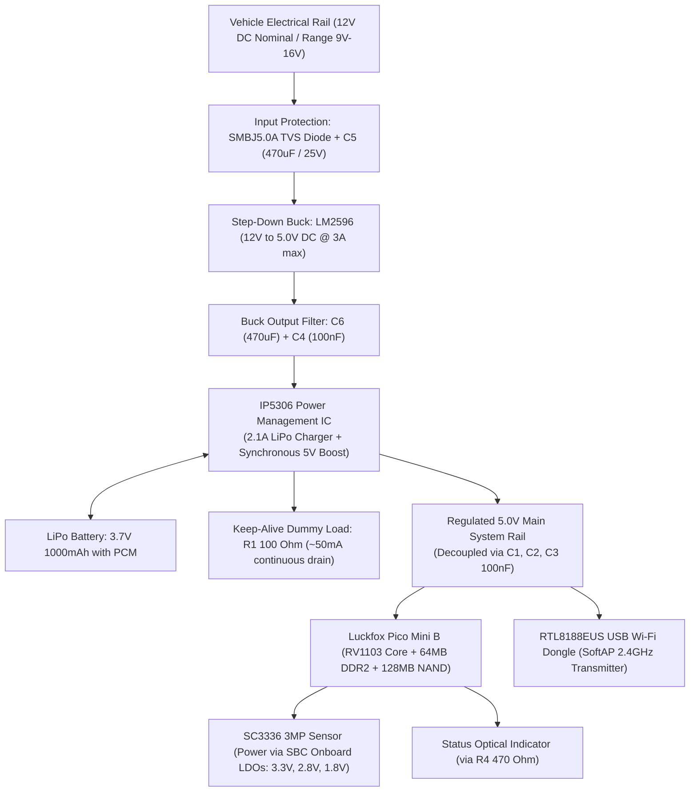

```text
╔══════════════════════════════════════════════════════════════════════════════════════════════════════╗
║ 1                                              2                                                   3 ║
║   ╔══════════════════════════════════════════════════════════════════════════════════════════════╗   ║
║ A ║ SPECIFICATION SHEET: ELECTRICAL POWER BUDGET & THERMAL ANALYSIS                              ║ A ║
║   ║ CLASSIFICATION: CONFIDENTIAL / PROTOTYPE ENGINEERING                                        ║   ║
║   ╚══════════════════════════════════════════════════════════════════════════════════════════════╝   ║
╚══════════════════════════════════════════════════════════════════════════════════════════════════════╝
```

# Engineering Specification: Electrical Power Budget & Thermal Analysis

---

## 1. Electrical Power Distribution Architecture



---

## 2. Electrical Current Schedule (Measured at 5.0V DC System Rail)

| Electrical Subsystem / Load Node | Standby / Idle Current (mA) | Active Streaming Current (mA) | Peak Transient Current (mA) | Operating Voltage (V) | Subsystem Power (W) |
|---|---|---|---|---|---|
| RV1103 ARM Cortex-A7 CPU Core | 50.0 | 120.0 | 180.0 | 5.0V DC | 0.60 W |
| Hardware ISP 3.2 Processing Core | 0.0 | 70.0 | 90.0 | 5.0V DC | 0.35 W |
| Hardware H.264 VPU Video Encoder | 0.0 | 50.0 | 70.0 | 5.0V DC | 0.25 W |
| On-Chip 64MB DDR2 Frame Buffer | 15.0 | 30.0 | 45.0 | 5.0V DC | 0.15 W |
| SC3336 3MP MIPI Camera Module | 0.0 | 75.0 | 110.0 | 5.0V DC | 0.38 W |
| RTL8188EUS USB Wi-Fi Adapter | 30.0 | 130.0 | 250.0 | 5.0V DC | 0.65 W |
| IP5306 Keep-Alive Load (R1: 100R) | 50.0 | 50.0 | 50.0 | 5.0V DC | 0.25 W |
| Status Indication LED (R4: 470R) | 0.0 | 7.0 | 10.0 | 5.0V DC | 0.035 W |
| **TOTAL SYSTEM RAIL CONSUMPTION** | **145.0 mA** | **532.0 mA** | **805.0 mA** | **5.0V DC** | **2.66 W (Active)** |

---

## 3. Battery Capacity & Operational Autonomy Calculation

- Battery Chemistry: Lithium-Cobalt-Oxide Polymer (LiPo)
- Rated Cell Potential: 3.7V DC Nominal (4.2V Peak Full, 3.0V Cutoff)
- Rated Nameplate Capacity: 1000 mAh
- Total Stored Energy: 3.7V x 1.0 Ah = 3.70 Watt-hours
- IP5306 Boost Conversion Efficiency (eta): 90.0%
- Effective Usable Electrical Energy: 3.70 Wh x 0.90 = 3.33 Watt-hours
- Continuous Active System Power Consumption: 5.0V x 0.532A = 2.66 Watts

### Continuous Autonomy Calculation:
```text
Autonomy (Active Stream) = Effective Energy / System Power
                         = 3.33 Wh / 2.66 W
                         = 1.25 Hours (75 Minutes continuous live video transmission)
```

In standby mode (with video sensor sleeping and Wi-Fi maintaining beacon packets at 145mA / 0.725W):
```text
Autonomy (Standby Mode)  = 3.33 Wh / 0.725 W
                         = 4.59 Hours (~275 Minutes)
```

---

## 4. Vehicle In-Line Charging & Thermal Balance

### Charging Phase Analysis:
- Step-down buck regulator (LM2596) supplies 5.0V DC at up to 2.0A from car battery.
- System base consumption: 532mA.
- Dedicated charge current diverted to LiPo cell: 2000mA - 532mA = 1468mA max (clamped internally by IP5306 to safe 1000mA 1C charge rate).
- Total battery recharge duration from 0% to 100% capacity during active streaming: ~65 minutes.

### Thermal Dissipation & Junction Constraints:
- RV1103 SoC Thermal Dissipation: ~0.80 Watts. Requires a 9mm x 9mm x 5mm extruded aluminum passive heatsink.
- LM2596 Module Dissipation: ~0.50 Watts conducted through module copper ground pour.
- IP5306 PMIC Dissipation: ~0.35 Watts during combined charging and boost operation.
- Ambient Temperature Envelope: 0 Deg C to 45 Deg C in vehicle cabin.
- Thermal Warning: Automotive windshield ambient temperatures in unshaded summer conditions can exceed 65 Deg C. LiPo charging must be inhibited if ambient temperature exceeds 45 Deg C.

---

```text
╔══════════════════════════════════════════════════════════════════════════════════════════════════════╗
║ B                                                                                                  B ║
║   ╔══════════════════════════════════════════════════════════════════════════════════════════════╗   ║
║   ║                                               ╔══════════════════════════════════════════════╣   ║
║   ║                                               ║ PROJECT:    DASHCAM PROTOTYPE PROJECT        ║   ║
║   ║                                               ║ TITLE:      ELECTRICAL POWER & THERMAL SPEC  ║   ║
║   ║                                               ║ DOC NUMBER: ENG-DASH-PWR-001   REVISION: 1.4 ║   ║
║   ║                                               ║ DATE:       2026-10-08         SHEET: 1 OF 1 ║   ║
║   ║                                               ╠══════════════════════════════════════════════╣   ║
║   ║                                               ║ LEAD ENGR:  Souvik H                         ║   ║
║   ║                                               ║ REGN NO:    IN-ENG-2022-22824                   ║   ║
║   ║                                               ║ DISCIPLINE: POWER ELECTRONICS & THERMAL ENGR ║   ║
║   ║                                               ║ STATUS:     RELEASED FOR PROTOTYPE FAB       ║   ║
║   ║                                               ║ FORMAT:     A4 STANDARD ENGINEERING SHEET    ║   ║
║   ╚═══════════════════════════════════════════════╩══════════════════════════════════════════════╝   ║
║ 1                                              2                                                   3 ║
╚══════════════════════════════════════════════════════════════════════════════════════════════════════╝
```
