```text
╔══════════════════════════════════════════════════════════════════════════════════════════════════════╗
║ 1                                              2                                                   3 ║
║   ╔══════════════════════════════════════════════════════════════════════════════════════════════╗   ║
║ A ║ SPECIFICATION SHEET: EMBEDDED SOFTWARE & VIDEO PIPELINE SPECIFICATION                       ║ A ║
║   ║ CLASSIFICATION: CONFIDENTIAL / PROTOTYPE ENGINEERING                                        ║   ║
║   ╚══════════════════════════════════════════════════════════════════════════════════════════════╝   ║
╚══════════════════════════════════════════════════════════════════════════════════════════════════════╝
```

# Engineering Specification: Embedded Software & Video Pipeline Specification

---

## 1. Operating System & Flash Memory Partitioning

The firmware executes from the onboard 128MB SPI NAND Flash of the Luckfox Pico Mini B under a tailored Buildroot Linux configuration.

```text
+--------------------------------------------------------------------------------------------------+
|                              128MB SPI NAND FLASH PARTITION SCHEME                               |
+-------------------+--------------------+------------------------+--------------------------------+
| U-BOOT BOOTLOADER | LINUX KERNEL IMAGE | ROOT FILESYSTEM (UBIFS)| USER CONFIGURATION / OVERLAY   |
| 4 MB (mtd0)       | 12 MB (mtd1)       | 64 MB (mtd2)           | 48 MB (mtd3)                   |
+-------------------+--------------------+------------------------+--------------------------------+
```

---

## 2. Hardware Video Processing Architecture

```mermaid
flowchart LR
    subgraph HW_PIPELINE ["Hardware Pipeline (Zero CPU Loading)"]
        SC3336["SC3336 Sensor\n(MIPI CSI-2 2-Lane)"] -->|"Raw Bayer 10-bit"| VI["Video Input (VI)\nController"]
        VI -->|"Direct Memory Access"| ISP["ISP 3.2 Hardware Core\n(3DNR, WDR, Auto Exposure)"]
        ISP -->|"YUV420SP Frame Buffers"| VENC["H.264 VPU Encoder\n(CBR 4 Mbps, 1080p @ 30fps)"]
    end

    subgraph USR_PIPELINE ["User Space Software Services"]
        VENC -->|"H.264 NAL Units"| DAEMON["dashcam_streamer\n(RKMPI C Daemon)"]
        DAEMON -->|"RTP Packets"| RTSP_SRV["RTSP Streamer Server\n(Port 554 Engine)"]
    end

    subgraph NET_TRANSPORT ["Wireless Network Interface"]
        RTSP_SRV -->|"TCP / UDP Socket"| WLAN0["wlan0 SoftAP\n(RTL8188EUS HostAPD)"]
        WLAN0 -.->|"IEEE 802.11n Wireless"| CLIENT["Smartphone Client (VLC App)"]
    end
```



---

## 3. Core Streamer Daemon Implementation (`dashcam_streamer.c`)

The streamer binary utilizes Rockchip Media Process Interface (RKMPI) bindings to chain camera capture directly to hardware video compression:

```c
#include <stdio.h>
#include <rk_mpi_vi.h>
#include <rk_mpi_venc.h>
#include <rk_mpi_sys.h>

int main(int argc, char *argv[]) {
    // Step 1: Initialize Rockchip Media Subsystem
    RK_MPI_SYS_Init();

    // Step 2: Configure Video Input Channel 0 (SC3336 Sensor)
    VI_CHN_ATTR_S vi_attr;
    vi_attr.stIspOpt.u32BufCount = 2; // Strict double buffering for 64MB DRAM
    vi_attr.stSize.u32Width = 1920;
    vi_attr.stSize.u32Height = 1080;
    vi_attr.enPixFmt = IMAGE_TYPE_NV12;
    RK_MPI_VI_SetChnAttr(0, 0, &vi_attr);
    RK_MPI_VI_EnableChn(0, 0);

    // Step 3: Configure Hardware H.264 Video Encoder
    VENC_CHN_ATTR_S venc_attr;
    venc_attr.stVencAttr.enType = RK_VIDEO_ID_AVC; // H.264 standard
    venc_attr.stVencAttr.u32Profile = 77;          // Main Profile
    venc_attr.stVencAttr.u32PicWidth = 1920;
    venc_attr.stVencAttr.u32PicHeight = 1080;
    venc_attr.stRcAttr.enRcMode = VENC_RC_MODE_H264CBR;
    venc_attr.stRcAttr.stH264Cbr.u32BitRate = 4000; // 4 Mbps
    venc_attr.stRcAttr.stH264Cbr.u32Gop = 30;       // 1 Keyframe per second
    RK_MPI_VENC_CreateChn(0, &venc_attr);

    // Step 4: Hardware Zero-Copy Binding: VI Chn 0 -> VENC Chn 0
    MPP_CHN_S stSrcChn = { .enModId = RK_ID_VI,   .s32DevId = 0, .s32ChnId = 0 };
    MPP_CHN_S stDstChn = { .enModId = RK_ID_VENC, .s32DevId = 0, .s32ChnId = 0 };
    RK_MPI_SYS_Bind(&stSrcChn, &stDstChn);

    // Step 5: Initialize RTSP Session & Serve Stream
    rtsp_demo_handle g_rtsplive = create_rtsp_demo(554);
    rtsp_session_handle g_rtsp_session = rtsp_new_session(g_rtsplive, "/live/0");
    rtsp_set_video(g_rtsp_session, RTSP_CODEC_TYPE_H264, NULL, 0);
    rtsp_sync_video_ts(g_rtsp_session, rtsp_get_reltime());

    // Step 6: Dispatch Encoded NAL Units to Network
    VENC_STREAM_S stFrame;
    stFrame.pstPack = malloc(sizeof(VENC_PACK_S));
    while (1) {
        if (RK_MPI_VENC_GetStream(0, &stFrame, 1000) == RK_SUCCESS) {
            void *pData = RK_MPI_MB_Handle2VirAddr(stFrame.pstPack->pMbBlk);
            rtsp_tx_video(g_rtsp_session, pData, stFrame.pstPack->u32Len, stFrame.pstPack->u64PTS);
            RK_MPI_VENC_ReleaseStream(0, &stFrame);
        }
    }
    return 0;
}
```

---

## 4. Boot-Up Automation Script (`/etc/init.d/S99dashcam`)

```bash
#!/bin/sh
case "$1" in
  start)
    echo "[DashCam] Initializing Automotive Vision System..."
    RkLunch-stop.sh 2>/dev/null

    # 1. Load Realtek 802.11n Wi-Fi kernel module
    modprobe 8188eu 2>/dev/null
    sleep 1

    # 2. Establish Wireless SoftAP Interface
    ifconfig wlan0 192.168.169.1 netmask 255.255.255.0 up
    hostapd -B /etc/hostapd.conf
    udhcpd /etc/udhcpd.conf

    # 3. Assert Status Indicator LED (GPIO48)
    echo 48 > /sys/class/gpio/export 2>/dev/null
    echo out > /sys/class/gpio/gpio48/direction
    echo 1 > /sys/class/gpio/gpio48/value

    # 4. Launch Hardware-Accelerated Video Streamer Daemon
    /usr/bin/dashcam_streamer &
    echo "[DashCam] RTSP Service Active at rtsp://192.168.169.1/live/0"
    ;;
  stop)
    killall dashcam_streamer
    killall hostapd
    ;;
esac
```

---

```text
╔══════════════════════════════════════════════════════════════════════════════════════════════════════╗
║ B                                                                                                  B ║
║   ╔══════════════════════════════════════════════════════════════════════════════════════════════╗   ║
║   ║                                               ╔══════════════════════════════════════════════╣   ║
║   ║                                               ║ PROJECT:    DASHCAM PROTOTYPE PROJECT        ║   ║
║   ║                                               ║ TITLE:      EMBEDDED SOFTWARE ARCHITECTURE   ║   ║
║   ║                                               ║ DOC NUMBER: ENG-DASH-SW-001    REVISION: 1.4 ║   ║
║   ║                                               ║ DATE:       2026-10-08         SHEET: 1 OF 1 ║   ║
║   ║                                               ╠══════════════════════════════════════════════╣   ║
║   ║                                               ║ LEAD ENGR:  Souvik H                         ║   ║
║   ║                                               ║ REGN NO:    IN-ENG-2022-22824                   ║   ║
║   ║                                               ║ DISCIPLINE: EMBEDDED SOFTWARE & FIRMWARE     ║   ║
║   ║                                               ║ STATUS:     RELEASED FOR COMPILATION         ║   ║
║   ║                                               ║ FORMAT:     A4 STANDARD ENGINEERING SHEET    ║   ║
║   ╚═══════════════════════════════════════════════╩══════════════════════════════════════════════╝   ║
║ 1                                              2                                                   3 ║
╚══════════════════════════════════════════════════════════════════════════════════════════════════════╝
```
